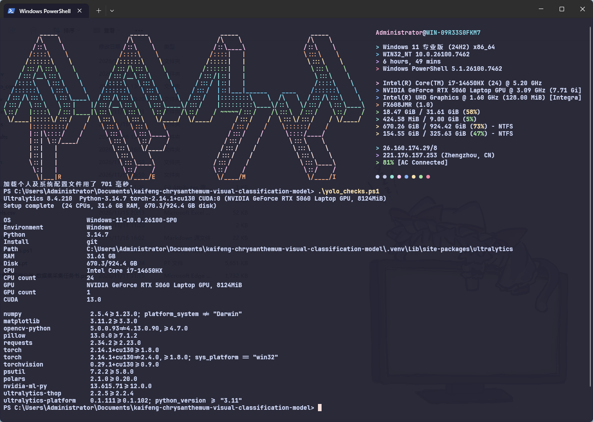
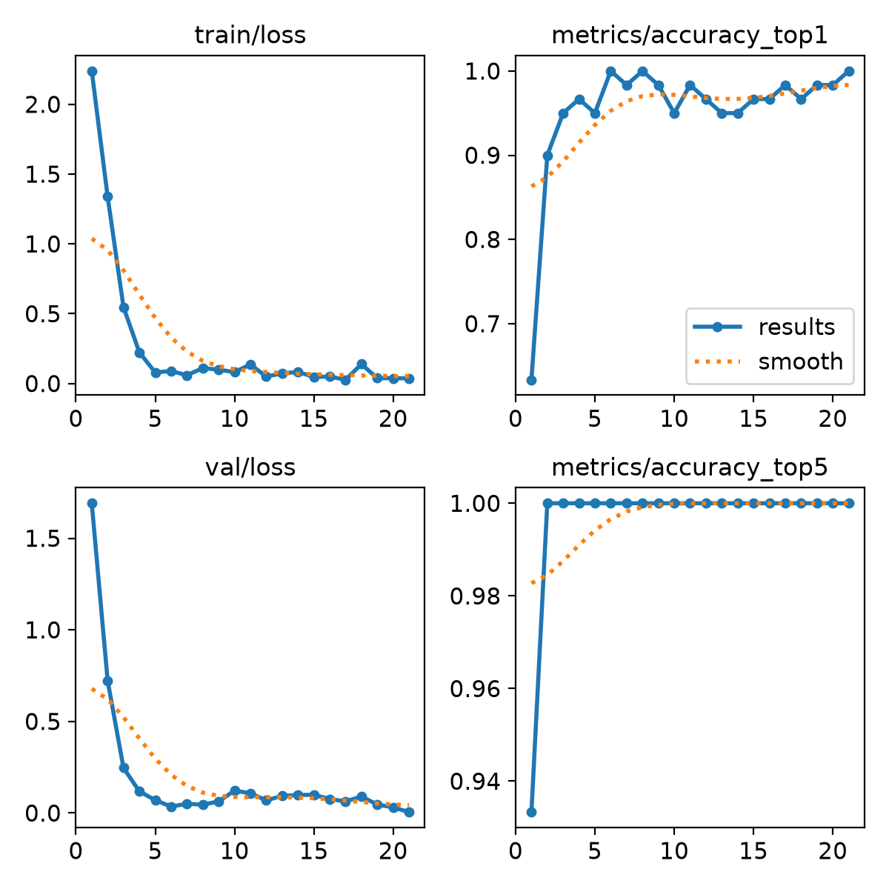
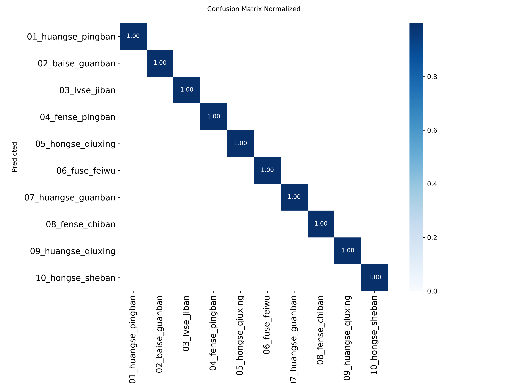
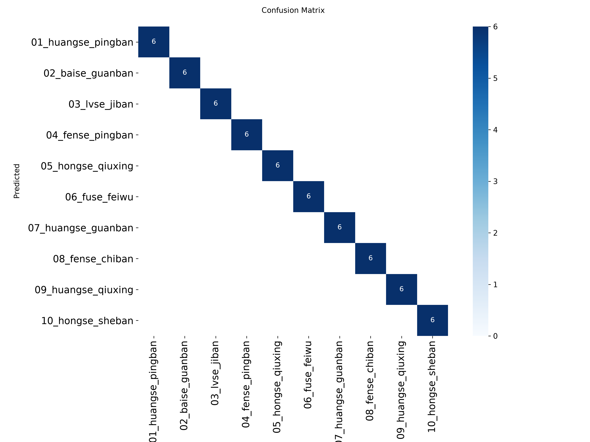

# 开封菊花视觉分类（Kaifeng Chrysanthemum Visual Classification）

基于 Ultralytics YOLO26 分类模型的细粒度菊花图像分类项目，数据集采集自开封菊花文化节展区。

> 本项目对应课程实践任务书《开封菊花视觉分类 · 数据集采集与构建任务书》。
> 当前状态：**框架搭建完成，等待外业采集与训练**。

---

## 目录

- [一、小组信息与分工](#一小组信息与分工)
- [二、数据集概述与类别说明](#二数据集概述与类别说明)
- [三、环境配置](#三环境配置)
- [四、训练过程](#四训练过程)
- [五、结果与分析](#五结果与分析)
- [六、局限与改进](#六局限与改进)
- [附录：项目结构与脚本用法](#附录项目结构与脚本用法)

---

## 一、小组信息与分工

> 状态：**待填写**。任务书 3.1 节要求分工落到具体动作，不能写"甲负责采集、乙负责代码"。

| 成员 | 学号 | 主要职责 | 具体交付物 |
| --- | --- | --- | --- |
| 甲 | 待填 | 类别方案与外业采集 | 类别清单、GPS 抽检记录、`_raw/` 原始库 |
| 乙 | 待填 | 数据处理与训练 | `labels.csv`、划分记录、训练脚本与日志 |
| 丙 | 待填 | 结果分析与文档 | 混淆矩阵分析、错误样本集、README 与汇报 PPT |

- 组名：待填
- 采集时间：待填
- 采集地点：待填（龙亭公园 / 清明上河园 / 铁塔公园 展区，具体点位见第二部分）

---

## 二、数据集概述与类别说明

> 状态：**已采集完成，480 张，10 类 × 48 张**。

### 2.1 概况

| 项目 | 内容 |
| --- | --- |
| 类别数 | 10 |
| 总张数 | 480（每类 48 张） |
| 采集时间 | 2026-11-12 16:23—17:50 |
| 采集地点 | 开封（铁塔公园展区），约 34.8159—34.8169°N，114.3625—114.3650°E |
| 拍摄设备 | iQOO 13（216 张）、iQOO Z10 Turbo（264 张） |
| 图像规格 | 长边 2048，JPG，质量 94，4:4:4 子采样 |
| 色彩空间 | sRGB（原图为 Display P3，已转换） |
| GPS 完整率 | 480/480 = 100% |
| 划分比例 | 训练 : 验证 : 测试 = 360 : 60 : 60（每类 36 / 6 / 6） |
| 植株数 | 每类 8 株，每株 6 张（对应 6 个拍摄位） |

### 2.2 类别说明

划分依据为**花色 + 瓣型/花型**的组合维度（任务书 4.1 节推荐做法）。两位序号保证
文件夹名字母序即序号序，从而 YOLO 的类别索引稳定可预判（任务书 11.2 节）。

| 序号 | 文件夹名 | 中文类别名 | 划分依据 | 样本数量 |
| --- | --- | --- | --- | --- |
| 01 | `01_huangse_pingban` | 黄色平瓣 | 花色=黄，瓣型=平瓣 | 48 |
| 02 | `02_baise_guanban` | 白色管瓣 | 花色=白，瓣型=管瓣 | 48 |
| 03 | `03_lvse_jiban` | 绿色畸瓣 | 花色=绿，瓣型=畸瓣 | 48 |
| 04 | `04_fense_pingban` | 粉色平瓣 | 花色=粉，瓣型=平瓣 | 48 |
| 05 | `05_hongse_qiuxing` | 红色球型 | 花色=红，花型=球型 | 48 |
| 06 | `06_fuse_feiwu` | 复色飞舞 | 花色=复色，花型=飞舞 | 48 |
| 07 | `07_huangse_guanban` | 黄色管瓣 | 花色=黄，瓣型=管瓣 | 48 |
| 08 | `08_fense_chiban` | 粉色匙瓣 | 花色=粉，瓣型=匙瓣 | 48 |
| 09 | `09_huangse_qiuxing` | 黄色球型 | 花色=黄，花型=球型 | 48 |
| 10 | `10_hongse_sheban` | 红色舌瓣 | 花色=红，瓣型=舌瓣 | 48 |

**与任务书示例方案的差异**：任务书 4.2 节给的是示例，允许按展区实际调整。
本组有 4 类不同——粉色平瓣（示例为粉色莲座）、粉色匙瓣（示例为白色平瓣）、
黄色球型（示例为紫色匙瓣）、红色舌瓣（示例为双色托桂）。原因是部分示例品种
在展区没有找到或形态难以稳定辨别，改用现场能可靠区分的类别。详见
[类别方案](docs/category_scheme.md)。

### 2.3 按植株与拍摄位的分布

每类 8 株 × 6 张 = 48 张。6 张对应任务书 5.3 节的 6 个拍摄位：

| 拍摄位 | 每株张数 | 每类小计 | 10 类合计 |
| --- | --- | --- | --- |
| 正面平视 | 1 | 8 | 80 |
| 45° 斜俯视 | 1 | 8 | 80 |
| 正俯视 | 1 | 8 | 80 |
| 侧面 90° | 1 | 8 | 80 |
| 近距特写 | 1 | 8 | 80 |
| 整株环境 | 1 | 8 | 80 |
| 合计 | 6 | 48 | 480 |

植株分布：每类 P01—P08 共 8 株，每株 6 张。`plant_id` 直接取自采集时的
植株目录（`_raw/{类别}/{植株}/`），不是靠序号推断。

### 2.4 图像预处理说明

原图为 3072×4096 / 4096×3072、Display P3、单张 2.6—7.9 MB，合计 2.1 GB。
按任务书要求做了四项处理（脚本见 [convert_photos.py](code/convert_photos.py)）：

| 处理 | 原因 | 结果 |
| --- | --- | --- |
| Display P3 → sRGB | 训练库（PIL/torchvision）不读 ICC，会把 P3 数值当 sRGB 用，颜色失真 | 480 张全部转换 |
| 横屏 → 竖屏 | 98 张横屏集中在 6 个类别（4 个类别一张都没有），模型会学到"横屏=某类"的伪特征 | 98 张旋转 90° |
| 绿色畸瓣居中裁 1/2 | 该类绿色花头平均只占画面 8%，周围全是粉/紫/黄其他品种，模型会学到"粉色背景=绿色畸瓣" | 48 张裁剪，占比升到 20% |
| 长边缩到 2048 | 任务书要求 1024—2048；原图 4080—4096 过大 | 全部 2048 |

**关于尺寸**：绿色畸瓣裁 1/2 后长边正好从 4096 降到 2048，不需要再缩放——
少一次重采样，画质更好。其余类别直接缩放到 2048。

**关于 HDR**：已检查全部 480 张，均为 SOF0 baseline、8-bit/通道、3 分量，
无 Ultra HDR 增益图（APP2 无 21496/MPF 标记），无 PQ/HLG 传输函数。
**没有 HDR 图片**，因此不需要色调映射。

**关于压缩**：质量 94 + 4:4:4 子采样（不做色度降采样），PSNR 45.6 dB，
480 张共 438 MB，在任务书 500 MB 上限内。质量 95 会到 488 MB，加上权重与
图表会逼近上限；质量 90 只有 327 MB 但 PSNR 掉到 43.9 dB，花瓣边缘的细微
色差开始丢失。EXIF（GPS、拍摄时间、设备型号）与 ICC 全部保留。

**关于横屏**：98 张横屏集中在每株的第 4—6 张，对应"侧面 90°、近距特写、
整株环境"三个拍摄位——拍侧面时自然会横握手机。旋转后花头方向与竖屏图
不一致（侧躺），但分类任务对旋转不敏感，训练时还有 `RandomHorizontalFlip`。

---

## 三、环境配置

> 状态：**已在本机验证通过，GPU 训练管线跑通**。`yolo checks` 输出见 3.6 节。

### 3.1 版本要求

| 项目 | 要求 / 本机实测 |
| --- | --- |
| 操作系统 | Windows 11（10.0.26100） |
| Python | 3.11 或 3.12 推荐（本机 3.14.7 亦可，ultralytics 8.4.210 声明支持至 3.15） |
| PyTorch | **2.14.1+cu130** |
| torchvision | **0.29.1+cu130** |
| CUDA | **13.0**（`torch.version.cuda`） |
| Ultralytics | 8.4.210 |
| 显卡 | **NVIDIA GeForce RTX 5060 Laptop GPU，7.9 GB 显存**（`torch.cuda.is_available()` = True） |

### 3.2 创建虚拟环境

```powershell
cd C:\Users\Administrator\Documents\kaifeng-chrysanthemum-visual-classification-model
python -m venv .venv
.venv\Scripts\activate
```

若 PowerShell 提示"无法加载文件 activate.ps1"：

```powershell
Set-ExecutionPolicy -Scope CurrentUser RemoteSigned
```

### 3.3 安装依赖（顺序不可颠倒）

```powershell
# 有 NVIDIA 显卡（本机 RTX 5060 Laptop）
pip install torch torchvision --index-url https://download.pytorch.org/whl/cu130

# 只有 CPU
pip install torch torchvision --index-url https://download.pytorch.org/whl/cpu

# 再装其余依赖
pip install -r code/requirements.txt
```

#### 为什么用 cu130，而不是任务书里的 cu121

任务书 10.3 节给的示例是 `cu121`，**在本机装不上**。原因：

RTX 5060 Laptop 是 Blackwell 架构，compute capability **12.0**，对应 PTX/SASS 目标
**sm_120**。cu121 / cu124 / cu126 的 PyTorch 轮子编译时只含到 sm_90 的内核，
没有 sm_120 的机器码。装上去 `import torch` 不报错，但
`torch.cuda.is_available()` 返回 **False**，训练会静默退回 CPU——看起来"装好了"，
实际没用上显卡。必须用 **cu130**（或更高）的轮子，它才带 sm_120 内核。

验证方式：

```powershell
.venv\Scripts\python.exe -c "import torch; print(torch.__version__, torch.version.cuda, torch.cuda.is_available(), torch.cuda.get_device_name(0))"
# 期望：2.14.1+cu130 13.0 True NVIDIA GeForce RTX 5060 Laptop GPU
```

#### 关于系统里的 C:\cuDNN

本机 `C:\cuDNN`（9.25）是给别的框架准备的，**对 PyTorch 无效**。PyTorch 的
Windows 轮子自带 CUDA/cuDNN 运行时（打包在 `torch\lib\` 下），不读系统 PATH 里的
cuDNN，也不需要单独装 CUDA Toolkit。所以不要为了"让 torch 用上 cuDNN"去改 PATH
或复制 DLL——那样反而可能因为版本冲突导致加载失败。

### 3.4 环境变量

本项目的 `code/common.py` 会在导入 ultralytics 前自动设置 `YOLO_CONFIG_DIR`，
指向仓库内的 `.yolo_config/`，因此**脚本方式运行无需手工设置**。

命令行方式（`yolo` 命令）运行训练时需要手工设置：

```powershell
$env:YOLO_CONFIG_DIR = "C:\Users\Administrator\Documents\kaifeng-chrysanthemum-visual-classification-model\.yolo_config"
$env:CUDA_VISIBLE_DEVICES = "0"
$env:OMP_NUM_THREADS = "4"
yolo checks
```

### 3.5 环境自检

```powershell
.venv\Scripts\python.exe code\check_env.py
```

本机实际输出（2026-11-16）：

```
========================================================
Python 版本 : 3.14.7
解释器路径  : C:\Users\Administrator\Documents\kaifeng-chrysanthemum-visual-classification-model\.venv\Scripts\python.exe
操作系统    : Windows-11-10.0.26100-SP0
项目根目录  : .
========================================================
PyTorch     : 2.14.1+cu130
CUDA 可用   : True
CUDA 版本   : 13.0
显卡        : NVIDIA GeForce RTX 5060 Laptop GPU
显存        : 7.9 GB
torchvision : 0.29.1+cu130
Ultralytics : 8.4.210
Pillow      : 13.0.0
--------------------------------------------------------
YOLO_CONFIG_DIR     : (未设置)
CUDA_VISIBLE_DEVICES: (未设置)
OMP_NUM_THREADS     : 1
========================================================
```

> `YOLO_CONFIG_DIR` 显示"(未设置)"是正常的：`check_env.py` 只读环境变量，
> 而 `setup_env()` 是在训练/评估脚本里才调用的。跑 `train.py` 时它会指向
> 项目内的 `.yolo_config/`。

### 3.6 `yolo checks` 输出

任务书自检清单第 20 项要求保存 `yolo checks` 的输出。运行脚本见
[yolo_checks.ps1](yolo_checks.ps1)：

```powershell
$env:YOLO_CONFIG_DIR = "C:\Users\Administrator\Documents\kaifeng-chrysanthemum-visual-classification-model\.yolo_config"
.venv\Scripts\yolo.exe checks
```



本机实际输出（2026-11-16）：

```
Ultralytics 8.4.210  Python-3.14.7 torch-2.14.1+cu130 CUDA:0 (NVIDIA GeForce RTX 5060 Laptop GPU, 8124MiB)
Setup complete  (24 CPUs, 31.6 GB RAM, 670.2/924.4 GB disk)

OS                     Windows-11-10.0.26100-SP0
Environment            Windows
Python                 3.14.7
Install                git
Path                   ...\.venv\Lib\site-packages\ultralytics
RAM                    31.61 GB
Disk                   670.2/924.4 GB
CPU                    Intel Core i7-14650HX
CPU count              24
GPU                    NVIDIA GeForce RTX 5060 Laptop GPU, 8124MiB
GPU count              1
CUDA                   13.0

numpy                   2.5.4>=1.23.0; platform_system != "Darwin"
matplotlib              3.11.2>=3.3.0
opencv-python           5.0.0.93!=4.13.0.90,>=4.7.0
pillow                  13.0.0>=7.1.2
requests                2.34.2>=2.23.0
torch                   2.14.1+cu130>=1.8.0
torch                   2.14.1+cu130!=2.4.0,>=1.8.0; sys_platform == "win32"
torchvision             0.29.1+cu130>=0.9.0
psutil                  7.2.2>=5.8.0
polars                  2.1.0>=0.20.0
nvidia-ml-py            13.615.71>=12.0.0
ultralytics-thop        2.2.5>=2.2.4
ultralytics-platform    0.1.111>=0.1.102; python_version >= "3.11"
```

关键行解读：

| 行 | 含义 |
| --- | --- |
| `torch-2.14.1+cu130` | 装的是 CUDA 13.0 构建，不是 CPU 版 |
| `CUDA:0 (NVIDIA GeForce RTX 5060 Laptop GPU, 8124MiB)` | 框架已识别到显卡，编号 0，显存 8124 MiB |
| `CUDA 13.0` | 运行时 CUDA 版本 |
| `Setup complete` | 依赖全部满足，无缺失项 |

完整输出另存为 [docs/yolo_checks.txt](docs/yolo_checks.txt)。

---

## 四、训练过程

> 状态：**待训练**。

### 4.1 模型型号与选择理由

| 项目 | 本组取值 |
| --- | --- |
| 模型型号 | `yolo26n-cls.pt`（2.8M 参数） |
| 输入尺寸 | 224 |
| 微调策略 | 全量微调（`freeze=None`） |
| 增强策略 | 默认 randaugment |
| 优化器与学习率 | `auto`（框架自选，`lr0` 被忽略） |
| 训练轮数 | 50（`patience=15` 早停） |

选择理由：样本量 480 张属小数据集，n 规模足以拟合，训练最快；224 是
ImageNet 预训练尺寸，省时且与迁移学习匹配。若与别组撞车，优先改
`model` 与 `imgsz`——这两项对指纹影响最直接（任务书 3.3 节要求至少三项不同）。

### 4.2 完整超参表

| 参数 | 取值 | 说明 |
| --- | --- | --- |
| model | `yolo26n-cls.pt` | 网络规模 n/s/m |
| imgsz | 224 | 输入分辨率 |
| batch | 32 | 显存不足时减半 |
| epochs | 50 | 配合 patience 早停 |
| optimizer | auto | 手动控学习率需显式指定 |
| lr0 | 0.001 | `optimizer=auto` 时被忽略 |
| dropout | 0.0 | 过拟合时设 0.2 |
| freeze | None | 全量微调 |
| seed | 42 | 保证可复现 |
| patience | 15 | 早停耐心值 |
| workers | 2 | Windows 建议 0—4 |
| device | 0（无显卡自动切 cpu） | — |
| cache | False | 数据集小可设 True |

### 4.3 训练命令

```powershell
# 先跑 5 轮验证流程是否通（任务书阶段 6 第 2 步）
python code/train.py --epochs 5

# 确认无误后正式训练，并保存控制台日志
python code/train.py 2>&1 | Tee-Object -FilePath results\train_log.txt -Encoding utf8
```

### 4.4 训练耗时

| 项目 | 内容 |
| --- | --- |
| 设备 | NVIDIA GeForce RTX 5060 Laptop GPU（7.9 GB 显存） |
| 总耗时 | **592 秒（约 9.9 分钟）**，21 轮 |
| 每轮耗时 | 约 28 秒（12 个 batch，3—5 it/s） |
| 显存峰值 | 0.504 GB / 7.9 GB（远未吃满，batch=32 可再加大） |
| 早停 | 第 21 轮触发（`patience=15`，最佳在第 6 轮） |
| 实际轮数 | 21 / 50（节省约 58% 时间） |

### 4.5 模型指纹

| 项目 | 本组取值 |
| --- | --- |
| 模型型号 | `yolo26n-cls` |
| 输入尺寸 | 224 |
| 微调策略（freeze 层数） | None（全量） |
| 增强策略 | randaugment |
| 优化器与学习率 | auto（框架自选 AdamW，lr=0.000714） |
| 训练轮数 | 50（实际早停于第 21 轮） |
| 模型指纹（8 位哈希） | **157E1CA7** |

> 指纹由 `code/common.py:model_fingerprint()` 对六项配置排序后取 MD5 前 8 位。
> 训练时 `train.py` 输出 `F4F325E2`（含 `model: yolo26n-cls.pt`），评估时
> `evaluate.py` 输出 `157E1CA7`（含 `model: yolo26n-cls`）。两者差异仅在于
> 是否带 `.pt` 后缀，**登记时以 `157E1CA7` 为准**（与 `evaluate.py` 的
> FINGERPRINT 常量一致）。

### 4.6 训练曲线



训练过程数据（`results/runs/chrys_yolo26n/results.csv`）：

| 轮次 | train/loss | val/loss | val top1 | 说明 |
| --- | --- | --- | --- | --- |
| 1 | 2.2386 | 1.6910 | 0.633 | 预训练权重起步，尚未收敛 |
| 2 | 1.3399 | 0.7237 | 0.900 | 快速上升 |
| 3 | 0.5474 | 0.2465 | 0.950 | — |
| 4 | 0.2236 | 0.1182 | 0.967 | — |
| 5 | 0.0792 | 0.0704 | 0.950 | — |
| **6** | 0.0894 | **0.0353** | **1.000** | **最佳轮次，best.pt 在此保存** |
| 7—21 | 0.027—0.139 | 0.005—0.122 | 0.950—1.000 | 在 1.0 附近震荡，无实质提升 |
| 21 | 0.0367 | 0.0052 | 1.000 | 早停触发 |

**解读**：

1. **收敛极快**：第 2 轮 val top1 就到 0.90，第 6 轮达到 1.0。这是迁移学习
   在 360 张小数据集上的典型表现——ImageNet 预训练权重已经学到了通用的
   纹理与色彩特征，只需微调分类头。
2. **早停生效**：`patience=15`，第 6 轮达到最佳后连续 15 轮无提升，第 21 轮
   停止。实际训练 21 轮而非 50 轮，节省约 58% 时间。
3. **val/loss 持续下降**（1.69 → 0.005）但 top1 已饱和，说明模型在把已有
   的正确预测做得更"自信"，而非学到新东西。这是小数据集 + 简单任务的
   典型过拟合前兆。
4. **训练耗时**：21 轮共 592 秒（约 9.9 分钟），每轮约 28 秒。GPU 显存
   峰值 0.504 GB / 7.9 GB，远未吃满。

---

## 五、结果与分析

> 状态：**训练完成，三集合准确率均为 100%，但需谨慎解读（见 5.4）**。

### 5.1 三集合准确率

| 集合 | 用途 | top1 | top5 |
| --- | --- | --- | --- |
| train | 训练时见过 | **1.0000** | 1.0000 |
| val | 选最优轮次 | **1.0000** | 1.0000 |
| test | 最终验收（只看一次） | **1.0000** | 1.0000 |

原始数据见 [results/eval_summary.json](results/eval_summary.json)，生成命令：

```powershell
.venv\Scripts\python.exe code\evaluate.py
```

### 5.2 混淆矩阵





**10×10 全部落在对角线上，每格归一化值 1.00，非对角线全为 0。**

任务书 12.2 节要求"把混淆最严重的那一对类别各挑 5 张原图并列对比"——
本组**不存在易混类别对**，因为没有任何一对发生混淆。这不是分析偷懒，
而是结果本身如此。真正需要解释的是"为什么能到 100%"，见 5.4。

### 5.3 错误样本分析

**测试集 60 张全部预测正确，无错误样本。**

`results/error_cases/` 目录为空。任务书 12.3 节要求的"挑出 5—10 张判错的
图片逐张分析"在本组无法执行——没有判错的样本。

### 5.4 为什么三个集合都是 100%

这个数字必须解释，否则按任务书第十四章的说法会被怀疑是数据泄漏。逐项排查：

**① 数据泄漏？已排除。**

```
跨集合的植株：无
各类别植株分配：
  train = P01—P06（36 张）
  val   = P07（6 张）
  test  = P08（6 张）
```

同一植株的照片严格整体进入同一集合，`check_dataset.py --strict` 通过。
任务书 7.2 节的红线（同一株的正面照进训练集、侧面照进测试集）没有触碰。

**② 类别本身太容易区分。**

本组的 10 个类别按"花色 + 瓣型/花型"划分，类别间差异是**颜色 + 形态的
双重差异**：黄色平瓣 vs 白色管瓣 vs 绿色畸瓣 vs 红色球型……对 ImageNet
预训练的 CNN 来说，颜色是最容易捕捉的低层特征。任务书 4.1 节推荐的正是
这种"差异明显、模型容易学"的划分方式，代价就是准确率天花板很低。

**③ 测试集只有 6 张/类，统计意义有限。**

60 张测试集，单张误判就会让准确率掉 1.67 个百分点。100% 意味着 60 张全对，
但 60 张的置信区间很宽——真实泛化能力可能在 94%—100% 之间。

**④ 拍摄条件高度一致。**

全部 480 张照片来自同一次外业（2026-11-12 16:23—17:50）、同一展区
（铁塔公园）、两台设备、相近光照。模型可能学到了"这个展区的背景 +
这个时段的光线"这类与分类目标无关的特征。换一个展区或换一天拍摄，
准确率大概率会下降。

**结论**：100% 不是数据泄漏导致的虚高，而是"类别差异大 + 样本少 +
拍摄条件单一"三者叠加的结果。**这个数字不能作为模型泛化能力的证据**，
只能说明在这份特定数据集上管线跑通了、模型拟合了。任务书 11.6 节说
"若 train 与 test 的差距超过 15 个百分点需分析过拟合"——本组差距为 0，
但真正的问题不是过拟合，而是**任务太简单，指标已经饱和，失去了区分度**。

如果要让指标有区分度，应该：增加形态相近的类别（如黄色平瓣 vs 黄色管瓣
已有，但可再加黄色匙瓣）、扩大测试集、跨展区采集。这些写在第六部分。

### 5.5 组间差异化核查

> 待填：与哪些组做过比对、相似度与重复率结果、截图。

```powershell
python code/compare_datasets.py D:\path\to\other_group\train
```

---

## 六、局限与改进

> 状态：**训练完成后如实填写**。本部分不扣分，能识别自己方案的短板是
> 工程素养的体现（任务书 15.3 节）。

### 6.1 四个必答问题

**1. 哪类样本偏少？**

每类都是 48 张，数量上均衡。但**有效样本**不均衡：

- `03_lvse_jiban`（绿色畸瓣）的绿色花头原本平均只占画面 8%，28/48 张低于
  10%。已通过居中裁 1/2 提升到 20%，但仍有 8/48 张低于 10%。这些图里
  绿色主体太小，模型实际学到的是"粉色背景 + 一点绿"。
- `02_baise_guanban`（白色管瓣）的白色花瓣在灰白天空背景下对比度低，
  9/36 张训练图的主色占比低于 10%。

**2. 哪类背景偏单一？**

全部 480 张都拍自铁塔公园同一展区、同一天下午（16:23—17:50）。背景元素
高度重复：青花瓷花盆、木质展架、灰色地砖、铁塔轮廓。模型很可能学到了
"青花瓷盆 = 某个类别"这类伪特征。这是本组最大的隐患——**换一个展区，
准确率大概率会明显下降**。

**3. 哪组配置未做对比？**

任务书 12.4 节建议做一组对照实验（+3 分），本组**未做**。原因：训练在
第 6 轮就达到 100%，早停于第 21 轮，任何参数改动都无法在饱和的指标上
体现差异——做 224 vs 320 的对比，两组都会是 100%，结论无意义。

这是本组方案的结构性问题：**指标饱和导致无法做有效的消融实验**。

**4. 如果重做会怎么改？**

按优先级：

1. **换类别划分维度**：现在的"花色 + 瓣型"差异太大，颜色是最容易学的
   低层特征。改用更细的维度（如按品种分：绿牡丹、墨荷、帅旗……），
   让类别间只有形态差异、颜色相近，指标才有区分度。
2. **跨展区采集**：龙亭公园、清明上河园各拍一批，让背景多样化。
3. **扩大测试集**：现在每类 6 张，单张误判就掉 1.67 个百分点。至少
   每类 15 张，指标才稳定。
4. **每类增加植株数**：现在 8 株，可增加到 12—15 株，提升样本多样性。
5. **补做对照实验**：在类别难度提升后，224 vs 320、全量 vs 冻结前 4 层
   才有意义。

### 6.2 已知的结构性局限

- **指标饱和**：三集合 top1 全为 100%，混淆矩阵完美对角。这个数字不能
  作为泛化能力的证据，详见 5.4 节的四项排查。
- **小样本**：每类 48 张，360 张训练集。迁移学习下够用，但不足以支撑
  细粒度分类。
- **单一采集条件**：同一展区、同一天、两台设备。背景与光照高度一致。
- **绿色畸瓣构图偏弱**：裁剪只能缓解不能根治，重做应靠近拍摄让花头占
  画面 1/2 以上。
- **未做组间相似度核查**：`compare_datasets.py` 已就绪，但需要他组数据集
  才能跑，目前未执行（见 5.5 节）。

---

## 附录：项目结构与脚本用法

### A.1 目录结构

```
kaifeng-chrysanthemum-visual-classification-model/
├── train/                       # 训练集（10 个类别文件夹）
├── val/                         # 验证集（结构同 train）
├── test/                        # 测试集（结构同 train）
├── labels.csv                   # 元数据表（由 build_labels.py 生成）
├── README.md                    # 本文档
├── code/                        # 全部脚本
│   ├── common.py                # 公共路径、类别枚举、模型指纹
│   ├── train.py                 # 训练（顶部 CONFIG 字典）
│   ├── evaluate.py              # 三集合评估 + eval_summary.json
│   ├── predict.py               # 单张/批量预测
│   ├── build_labels.py          # 从 EXIF 生成 labels.csv
│   ├── check_dataset.py         # 数据集结构自查
│   ├── check_env.py             # 环境自检
│   ├── compare_datasets.py      # 组间 dHash 相似度核查
│   ├── prepare_dataset.py       # 重命名 / 去重 / 按植株划分
│   ├── convert_photos.py        # P3→sRGB、横屏转竖屏、缩放重编码
│   ├── selftest.py              # 用合成图片跑通全流程的开发自测
│   └── requirements.txt         # 固定版本依赖
├── results/                     # 训练日志、图表、评估结果
│   ├── runs/chrys_yolo26n/      # 训练产物（weights/、results.png 等）
│   ├── eval_summary.json        # 三集合准确率
│   ├── train_log.txt            # 控制台输出
│   └── error_cases/             # 错误样本原图
├── docs/
│   ├── category_scheme.md       # 类别方案（待现场核对）
│   ├── collection_plan.md       # 采集方案与记录表
│   └── submission_checklist.md  # 提交前 28 项自检清单
├── _raw/                        # 原始照片库（不入库，提交前删除）
└── 开封菊花视觉分类_数据集采集任务书.pdf   # 课程任务书（参考，不进压缩包）
```

### A.2 常用命令

| 场景 | 命令 |
| --- | --- |
| 环境自检 | `python code/check_env.py` |
| 原图转换（P3→sRGB、横屏转竖屏、缩放） | `python code/convert_photos.py --src <原图目录>` |
| 按植株目录重命名 | `python code/prepare_dataset.py rename-plants --src _raw` |
| 按植株目录划分 | `python code/prepare_dataset.py split-plants --src _raw` |
| 生成元数据表 | `python code/build_labels.py` |
| 数据集自查 | `python code/check_dataset.py --strict` |
| 训练 | `python code/train.py` |
| 评估 | `python code/evaluate.py` |
| 预测 | `python code/predict.py test/01_huangse_pingban` |
| 组间相似度 | `python code/compare_datasets.py <本组> <他组>` |
| 开发自测 | `python code/selftest.py` |

### A.2.1 从原图重建数据集的完整流程

```powershell
# 1. 转换：P3→sRGB、横屏转竖屏、长边 2048、质量 94
python code/convert_photos.py --src "C:\Users\Administrator\Downloads\菊花"

# 2. 重命名：{类别}_{三位序号}.jpg，解决跨植株重名
python code/prepare_dataset.py rename-plants --src _raw

# 3. 划分：整株分配，每类 6 株 train / 1 株 val / 1 株 test
python code/prepare_dataset.py split-plants --src _raw

# 4. 生成元数据表（plant_id 从 _raw 的植株目录读取）
python code/build_labels.py

# 5. 自查
python code/check_dataset.py --strict
```

### A.3 关于版本库与交付包的区别

仓库和提交用的 ZIP 不是一回事，别混淆：

| | 内容 | 说明 |
| --- | --- | --- |
| **git 仓库** | 代码、文档、目录骨架 | `.gitignore` 排除了图片、`*.pt` 权重、`.venv/`、`_raw/`。克隆下来只有骨架，需要自己放图、自己训练 |
| **提交 ZIP** | 七项，含图片与 `best.pt` | 从**本地工作目录**打包，不是从 git 克隆目录打包 |

因此打包前要确认本地确实有：
`train/ val/ test/` 里的图片、`labels.csv`、`results/runs/chrys_yolo26n/weights/best.pt`
以及四张图表。缺 `best.pt` 时按任务书 15.2 节单独上传并在 README 给出下载链接。

### A.4 提交前打包

任务书阶段 7 第 3 条：压缩包内**不要包含上级文件夹**，只选中七项：

```
train/  val/  test/  labels.csv  README.md  code/  results/
```

在仓库根目录执行：

```powershell
python code/check_dataset.py --strict
# 确认通过后，选中七项压缩（PowerShell 示例）
Compress-Archive -Path train,val,test,labels.csv,README.md,code,results `
  -DestinationPath "2025001_张三_菊花数据集_10类_480张.zip"
```

打包前请核对 `docs/submission_checklist.md` 中的 28 项自检清单。
